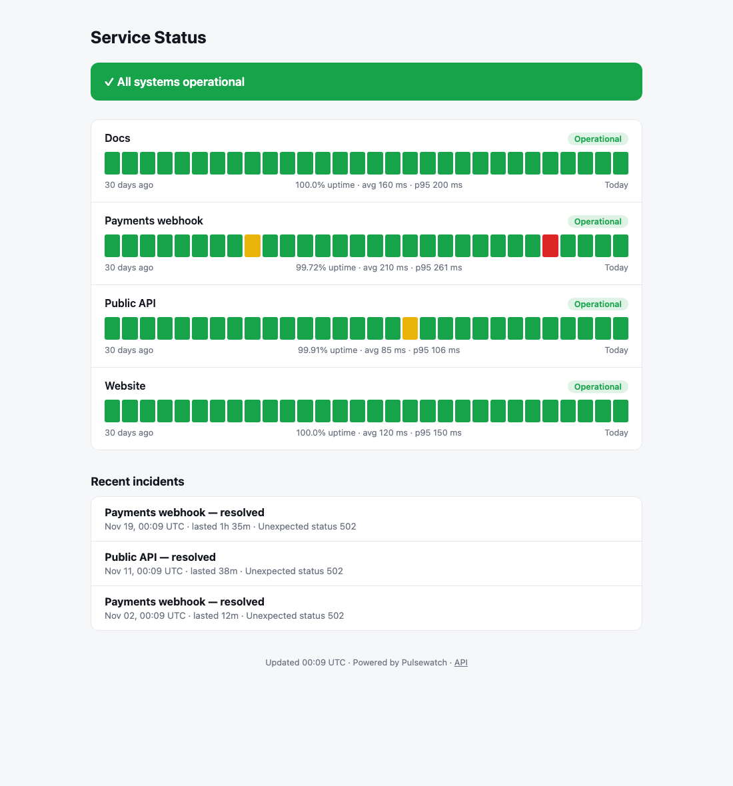
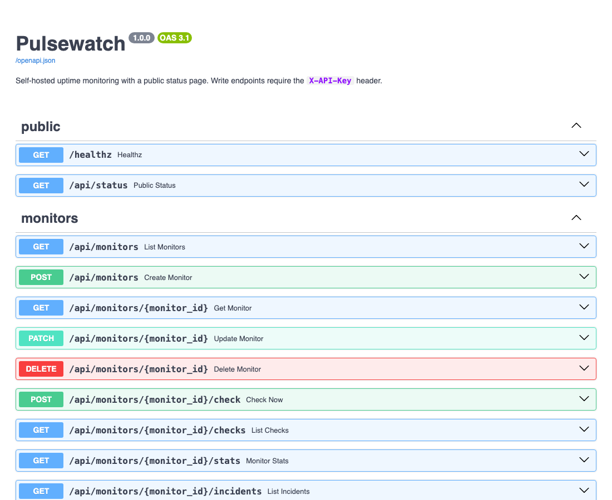
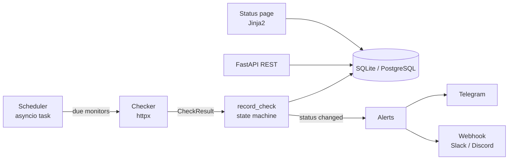

# Pulsewatch

[](https://github.com/SergeyZheskiy/pulsewatch/actions/workflows/ci.yml)


**Self-hosted uptime monitoring** — a small, readable alternative to UptimeRobot / Statuspage. Pulsewatch probes your sites and APIs on a schedule, keeps history, opens and closes incidents, alerts you in Telegram / Slack / Discord, and publishes a public status page and README badges.



## Features

- **HTTP checks** on a per-monitor interval: expected status code, keyword in body, timeout, GET/HEAD
- **Flap protection** — a monitor goes DOWN only after *N* consecutive failures (default 2); one success brings it back UP
- **Incidents** opened and resolved automatically, with downtime duration
- **Alerts** to Telegram and any webhook (payload works with Slack and Discord incoming webhooks as-is); a broken channel never blocks the others
- **Public status page** — 30-day uptime bars, avg / p95 latency, recent incidents, dark mode, no JavaScript
- **Uptime badges** for READMEs: `` → 
- **REST API** with OpenAPI docs at `/docs`, API-key auth for write operations
- **Basic SSRF guard**: refuses `localhost`, private and cloud-metadata addresses unless explicitly allowed
- SQLite out of the box, **PostgreSQL** via one env var; Docker image with healthcheck, runs as non-root

## Quick start

```bash
python -m venv .venv && source .venv/bin/activate
pip install -e ".[dev]"
cp .env.example .env            # set PULSEWATCH_API_KEY
python scripts/seed_demo.py     # optional: 30 days of demo history
python -m pulsewatch            # http://localhost:8000 and http://localhost:8000/docs
```

With Docker and PostgreSQL:

```bash
cp .env.example .env
docker compose up -d --build
```

### Add a monitor

```bash
curl -X POST localhost:8000/api/monitors \
  -H "X-API-Key: $PULSEWATCH_API_KEY" -H "Content-Type: application/json" \
  -d '{"name": "Website", "url": "https://example.com", "interval_seconds": 60, "keyword": "Example Domain"}'
```

## API

| Method | Path | Auth | Description |
| --- | --- | --- | --- |
| GET | `/` | — | Public status page |
| GET | `/badge/{id}.svg` | — | 30-day uptime badge |
| GET | `/api/status` | — | Public monitors as JSON |
| GET / POST | `/api/monitors` | key | List / create monitors |
| GET / PATCH / DELETE | `/api/monitors/{id}` | key | Read / update / delete |
| POST | `/api/monitors/{id}/check` | key | Run a check right now |
| GET | `/api/monitors/{id}/checks` | key | Check history |
| GET | `/api/monitors/{id}/stats?hours=24` | key | Uptime %, avg and p95 latency |
| GET | `/api/monitors/{id}/incidents` | key | Incident history |



## Architecture



- `checker.py` — one HTTP probe, **never raises**: every failure becomes a `CheckResult` with a human-readable error
- `service.py` — pure state machine (`up` / `down` / `unknown`) plus incident bookkeeping
- `scheduler.py` — finds due monitors each tick, runs them concurrently under a semaphore, skips monitors already in flight
- `stats.py` — per-day uptime aggregated **in SQL**, p95 latency by nearest rank
- `main.py` — app factory; the HTTP transport is injectable, which is how tests swap the network for a fake

## Testing

```bash
pytest -q          # 43 tests, ~1s, no network access
ruff check . && ruff format --check .
```

The test suite uses an in-memory SQLite database and an `httpx.MockTransport` "fake internet" with healthy, failing, slow, refusing and flapping hosts. It covers the full outage lifecycle: tolerated blip → DOWN → alerts sent → incident opened → recovery → incident resolved with duration. CI runs on Python 3.11–3.13 and smoke-tests the Docker image.

## Design notes and limits

- One process runs the scheduler. To scale horizontally you would move checks to a queue (e.g. Redis + workers) — deliberately out of scope.
- Timestamps are stored as naive UTC and serialised with an explicit `Z`.
- The SSRF guard checks literal IPs and local hostnames; it does not resolve DNS, so it is a safety net, not a sandbox. Keep the API key secret.
- Tables are created on startup; a production deployment with schema changes would add Alembic migrations.

## License

MIT
